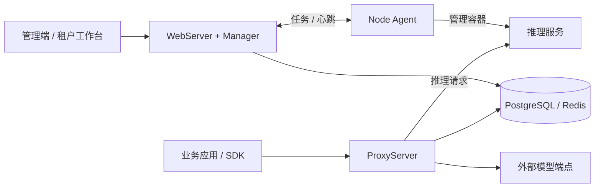

# LLMPod 后端开发指南

[](../../pyproject.toml)

本文包含后端技术架构、本地开发环境和项目结构。除获取源码的步骤外，开发命令均在项目根目录执行。

[文档目录](../README.md) · [源码开发](#源码开发) · [API 接入](../usage/api.md) · [Docker 部署](../usage/deployment.md)

## 架构概览

管理端、API 网关与节点代理各自承担独立职责。WebServer 与 Manager 运行在同一个管理端应用中，推理请求由 ProxyServer 转发到实际模型服务。



| 组件 | 职责 |
| --- | --- |
| **WebServer + Manager** | 提供管理界面和 REST API，管理集群、模型、租户与部署编排 |
| **ProxyServer** | 接收推理请求，执行鉴权、访问控制、路由转发和用量记录 |
| **Node Agent** | 通过 WebSocket 连接管理端，管理推理容器并上报节点与设备状态 |
| **PostgreSQL + Redis** | 存储业务数据，提供缓存与运行状态共享 |

## 源码开发

后端基于 Python / FastAPI。

### 环境要求

| 工具 | 要求 |
| --- | --- |
| Python | `3.12+`，使用 `uv` 管理依赖 |
| Docker | Docker Engine 与支持 `docker compose` 命令的 Compose 插件 |
| Git / Make | 获取源码与执行仓库提供的开发命令 |

运行模型还需准备与推理镜像匹配的计算设备、驱动和容器运行环境。

### 启动后端

```bash
git clone https://cnb.cool/btpanel/llmpod.git
cd llmpod
make setup
```

`make setup` 会在配置文件不存在时从模板生成 `.env` 和 `docker/.env.deps`，安装 Python 依赖、启动 PostgreSQL / Redis，并初始化数据库。若修改数据库或 Redis 配置，请保持两份文件中的连接信息一致。

在不同终端中，从项目根目录分别启动管理端和 API 网关：

```bash
# 终端 1：管理端，默认 http://127.0.0.1:8080
make dev
```

```bash
# 终端 2：API 网关，默认 http://127.0.0.1:8090
make dev-proxy
```

本地开发模板的初始管理员为 `admin` / `admin`，仅用于开发。使用已有数据库时，账号以首次初始化时的配置为准。服务器部署请参阅 [README 快速开始](../../README.md#快速开始)或 [Docker 部署指南](../usage/deployment.md)。

### 常用命令

以下命令均在项目根目录执行：

| 命令 | 用途 |
| --- | --- |
| `make test` | 运行后端测试 |
| `make test-e2e` | 创建独立 Docker 测试栈并运行端到端测试 |
| `make lint` | 运行后端 Ruff 检查 |
| `make deps-down` | 停止本地 PostgreSQL / Redis，保留数据卷 |

## 项目结构

```text
llmpod/
├── llmpod/                 # Python 后端
│   ├── apps/               # 管理端、网关、节点代理
│   ├── models/             # 数据模型
│   ├── services/           # 业务逻辑
│   └── tunnel/             # 管理端与节点通信
├── docs/                   # 部署、API 与后端开发文档
├── docker/                 # 镜像与 Compose 配置
├── alembic/                # 数据库迁移
├── scripts/                # 初始化与运维脚本
├── tests/                  # 单元、集成与端到端测试
└── Makefile                # 开发、构建与检查命令
```
